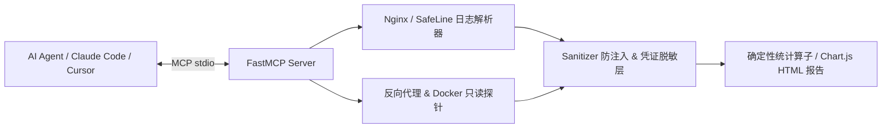

# 🛡️ waf-secops-mcp — 面向 WAF 与安全运维的只读 AI Agent MCP 服务

> 基于开源 `aws-waf-mcp-server` 架构二次开发，吸收 `dlia` 安全边界设计，专为 **Nginx / 雷池 SafeLine WAF 日志取证、容器交付排障与防提示词注入** 打造。

### 🌐 [点击在线零门槛交互体验（无需安装，浏览器直接试玩）](https://kele3377.github.io/waf-secops-mcp/)
> 支持直接粘贴任意 Nginx / SafeLine 日志实时体验 **WAF 攻击取证 + 日志 Prompt 注入清洗 + 密钥脱敏 + 反向代理源 IP 审计 + Docker OOM (137) 诊断**！

## ✨ 核心特性

1. **本土化多源 WAF 日志解析**：去除了原版 AWS S3 强依赖，统一支持本地 **Nginx Access Log** 与 **雷池 SafeLine JSON 日志**（`.log` / `.json` / `.gz`）。
2. **双层安全防线（防注入 + 脱敏）**：
   - **防日志 Prompt 注入（Sanitizer）**：自动识别并中和攻击者在 URI / User-Agent 中夹带的恶意提示词指令（如 `Ignore all previous instructions...`）。
   - **敏感凭证脱敏（Anonymizer）**：在日志数据进入大模型上下文前，自动对 JWT、Bearer Token、API Key、Cookie 进行掩码打码。
3. **确定性统计 + 安全交付排障**：
   - **6 个只读 MCP 工具**：流量与拦截率确定性统计、SQLi/XSS/路径穿越/敏感文件探测识别、按 IP 时间线溯源、Nginx 反向代理源 IP 透传审计（`X-Real-IP` / `X-Forwarded-For`）、Docker 容器 OOM（Exit 137）诊断。
4. **交互式中文安全态势报告**：一键生成基于 **Chart.js** 的交互式 HTML 报告，直观呈现每小时请求趋势、攻击类型分布与脱敏取证表。

## 📐 架构设计



## 🚀 快速运行与测试

```bash
# 1. 安装依赖
pip install -r requirements.txt

# 2. 运行完整自动化单元测试（覆盖日志解析、防注入脱敏、代理审计、HTML报告）
pytest -v

# 3. 一键生成示例交互式 HTML 安全态势报告
python -c "from src.report_html import generate_security_html_report; print(generate_security_html_report('data/sample_waf_nginx.log', 'reports/demo_report.html'))"
```

## 🐳 Docker 只读沙箱部署

项目附带 `Dockerfile` 与 `docker-compose.yml`（默认采用 `read_only: true` 只读挂载日志目录，防止 Agent 越权写宿主机）。

## 📄 开源致谢

详见 [ATTRIBUTION.md](ATTRIBUTION.md)。
